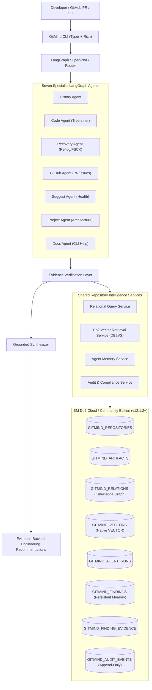
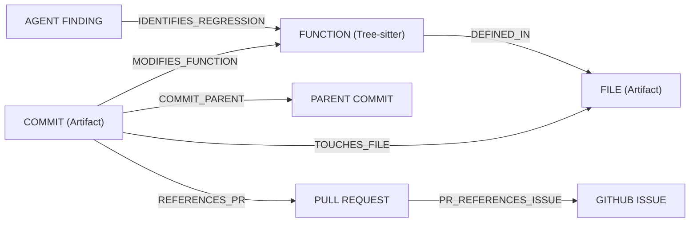
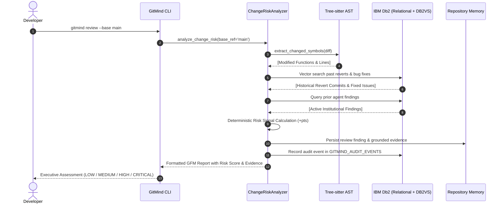

# GitMind 2.0 — System Architecture & IBM Db2 Technical Specification

## 1. Architectural Overview

GitMind 2.0 transforms software version history, Tree-sitter code symbols, pull requests, issues, and previous engineering investigations into a persistent, searchable, and auditable knowledge system powered by **IBM Db2**.



---

## 2. Agent Orchestration (LangGraph Functional Workflows)

GitMind 2.0 preserves and expands GitMind's existing LangGraph orchestration using functional `@entrypoint` and `@task` primitives. The system decouples LLM generation from unrestricted database access:

1. **Query Router (`workflows/router.py`):**
   - Classifies user intent into a primary specialist agent and optional secondary context agents.
   - Provides fast-paths for deterministic CLI commands (`story`, `review`, `explain`, `project`).
2. **Seven Specialist Agents:**
   - **History Agent:** Investigates commit history, evolution narratives, author blame, and feature progression using `git log` and Db2 vector search.
   - **Code Agent:** Uses Tree-sitter AST parsing (Python, JavaScript, TypeScript) to extract functions, classes, line boundaries, and AST change diffs.
   - **Recovery Agent:** Scans `git reflog` and `git fsck` dangling objects to generate non-destructive recovery plans for lost branches or stashes.
   - **GitHub Agent:** Traces the human intent chain from `commit -> pull request -> issue`.
   - **Suggest Agent:** Proactively analyzes repository health, detecting unpushed commits, detached HEAD states, stale branches, and merge conflicts.
   - **Project Agent:** Synthesizes architecture, READMEs, project metadata, and developer onboarding instructions.
   - **Docs Agent:** Surfaces verified Git command documentation and configuration options.
3. **Evidence Verification Layer (`workflows/synthesizer.py`):**
   - Automatically parses candidate commit hashes, file paths, and PR numbers from raw agent outputs.
   - Queries Db2 to verify whether each citation exists in repository records.
   - Flags unsupported claims as `[UNGROUNDED]` and validates grounded claims as `[VERIFIED]`.
   - Ensures the final response distinguishes **Verified Facts**, **Historical Inferences**, and **AI Recommendations**.

---

## 3. IBM Db2 Foundation & Vector Intelligence

### 3.1 Official `langchain-db2` Connector (`DB2VS`)
Vector operations are implemented directly via the official `langchain-db2` package:
```python
from langchain_db2 import DB2VS
from langchain_db2.db2vs import DistanceStrategy

db2vs = DB2VS(
    embedding_function=embeddings,
    table_name="GITMIND_VECTORS",
    client=ibm_db_conn,
    distance_strategy=DistanceStrategy.COSINE,
    query="GitMind vector probe",
    text_field="text",
)
```

### 3.2 Native Db2 Vector Execution
The underlying vector table is structured per the official specification:
- `id`: `CHAR(16) PRIMARY KEY NOT NULL` (Deterministic SHA-256 hash prefix)
- `text`: `CLOB` (Raw chunk text)
- `metadata`: `BLOB` (Binary JSON encoded via `SYSTOOLS.JSON2BSON`)
- `embedding`: `vector({dimension}, FLOAT32)` (Native Db2 vector column)

Vector similarity queries execute directly inside IBM Db2 using native SQL:
```sql
SELECT id, text, SYSTOOLS.BSON2JSON(metadata),
       VECTOR_DISTANCE(embedding, VECTOR(?, 768, FLOAT32), COSINE) AS distance
FROM GITMIND_VECTORS
ORDER BY distance
FETCH FIRST 5 ROWS ONLY
```

### 3.3 Dynamic Dimension Detection
Rather than assuming a hardcoded 768 dimension, GitMind 2.0 probes the active embedding model (`models/gemini-embedding-001` -> 768, `text-embedding-3-small` -> 1536) and dynamically allocates the vector dimension.

---

## 4. Repository Knowledge Graph (`GITMIND_RELATIONS`)

The Knowledge Graph connects isolated artifacts into a navigable relational network inside Db2:



Relations are stored with foreign-key constraints and unique indices in `GITMIND_RELATIONS`:
- `RELATION_ID VARCHAR(64) PRIMARY KEY`
- `REPO_ID VARCHAR(64) REFERENCES GITMIND_REPOSITORIES(REPO_ID)`
- `SOURCE_ARTIFACT_ID VARCHAR(64) REFERENCES GITMIND_ARTIFACTS(ARTIFACT_ID)`
- `TARGET_ARTIFACT_ID VARCHAR(64) REFERENCES GITMIND_ARTIFACTS(ARTIFACT_ID)`
- `RELATION_TYPE VARCHAR(64)`
- `CREATED_AT TIMESTAMP`

This allows deterministic SQL graph traversal (including Db2 recursive CTEs for commit lineage) without requiring a separate graph database.

---

## 5. Persistent Multi-Agent Engineering Memory

GitMind 2.0 maintains institutional memory across developer sessions:
1. When an agent discovers a noteworthy conclusion (e.g. historical bug fix, regression risk, revert precedent), it creates an `AgentFinding` model.
2. The finding is saved into `GITMIND_FINDINGS` and its citations into `GITMIND_FINDING_EVIDENCE`.
3. The finding summary is embedded and stored in `GITMIND_VECTORS`.
4. Subsequent investigations retrieve prior relevant findings via semantic search (`gitmind memory search "authentication regression"`) or relational queries.

---

## 6. Signature Differentiator: Historical Change-Risk Intelligence (`gitmind review`)



### Explainable Risk Signals
| Signal ID | Description | Default Weight |
|---|---|---:|
| `HISTORICAL_REVERT` | Similar implementation was previously reverted | +35.0 pts |
| `PREVIOUS_REGRESSION` | Function previously suffered a reported regression | +30.0 pts |
| `SECURITY_SENSITIVE` | Authentication, token, credential, or crypto code touched | +25.0 pts |
| `VERIFIED_BUG_FIX_FILE` | File has a history of verified bug fixes | +20.0 pts |
| `DATABASE_MIGRATION` | Schema, migration, or public persistence model changed | +20.0 pts |
| `UNRESOLVED_FINDING` | Component has active prior agent findings | +20.0 pts |
| `MISSING_TEST_UPDATE` | Logic changed without accompanying test additions/updates | +15.0 pts |

---

## 7. Security Architecture & Guardrails

- **Zero Secret Ingestion:** Regex scanning automatically redacts OpenAI, Gemini, GitHub, AWS, private keys, and bearer tokens before embedding or LLM transmission.
- **Strict File Exclusion:** Sensitive files (`.env`, `*.pem`, `*.key`, `id_rsa`, `.git/`, binaries, build directories) are rejected by `is_path_safe_for_indexing()`.
- **Repository Isolation:** Every SQL query and DB2VS vector retrieval is parameter-filtered by `REPO_ID` to guarantee zero multi-tenant cross-repository data leakage.
- **Git Safety:** Safe runner disallows destructive commands (`push --force`, `reset --hard`, `branch -D`, `stash drop`, `tag -d`) without explicit developer confirmation.
- **Append-Only Compliance Audit:** `GITMIND_AUDIT_EVENTS` records an immutable audit log of all indexing runs, agent executions, review analyses, and approvals.
